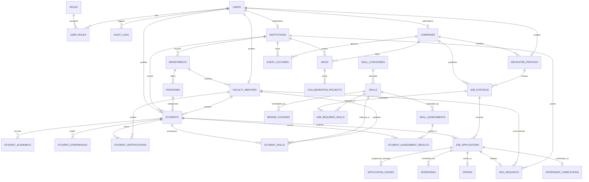

# Database Architecture & Design Specification
## SIH 2026 Problem Statement: SIH26044
**Portal for Academia-Industry Collaboration for Skill Mapping, Internships, and Placement**  
**Sponsoring Ministry:** Ministry of Ayush / Higher Education Ecosystem  
**Repository Path:** `database/`

---

## 1. Executive Summary & Problem Alignment

### The Core Challenge
Traditional college placement portals operate as passive job listing boards where:
1. Students list unverified self-claimed skills.
2. Industry recruiters struggle to evaluate real domain proficiencies.
3. Academic institutions have zero visibility into emerging skill trends to update their syllabus.
4. Formal Memorandums of Understanding (MoUs) between universities and companies sit as inactive paper documents.

### The Solution Engineered in this Schema
This database implements an **active, data-driven collaboration ecosystem**:
- **Standardized Skill Ontology & Multi-Level Verification**: Separates self-reported skills from faculty-verified, assessment-tested, and project-proven competencies.
- **Dynamic Skill-Gap Matching Engine**: Mathematically computes match percentages between candidates and job specifications (accounting for mandatory vs. preferred skills) and immediately binds missing competencies to accredited bridge courses (e.g., NPTEL, Swayam, CCRAS).
- **Institutional Governance**: Full dual-tier digital NOC (No Objection Certificate) workflows, internship logbook tracking, and industry feedback.
- **MoU Lifecycle & Collaboration Tracking**: Actively monitors industry-sponsored R&D projects, guest lectures, and internship quota fulfillment.

---

## 2. Complete Entity-Relationship (ER) Diagram



---

## 3. Data Dictionary (Module by Module)

### Domain 1: Access Control & User Identity
| Table | Key Columns | Purpose & Business Logic |
|---|---|---|
| `roles` | `role_id`, `role_code`, `role_name` | Master list of system roles with distinct privileges (`SUPER_ADMIN`, `MINISTRY_OFFICER`, `TPO`, etc.) |
| `users` | `user_id` (UUID), `email`, `password_hash`, `is_active` | Unified identity table with bcrypt hashing, active flags, and timestamps |
| `user_roles` | `user_id`, `role_id` | Junction table supporting users holding multiple roles (e.g. a Faculty can also be a TPO) |
| `audit_logs` | `log_id`, `user_id`, `action_type`, `payload` (JSONB) | Tamper-evident trail for statutory audits (NOC approvals, offer releases, MoU creations) |

### Domain 2: Academic Institutions & Faculty
| Table | Key Columns | Purpose & Business Logic |
|---|---|---|
| `institutions` | `institution_id`, `aishe_code`, `name`, `accreditation_grade` | Accredited universities, colleges, and national institutes (e.g. NIA, AIIA) |
| `departments` | `department_id`, `institution_id`, `department_name`, `hod_email` | Academic units (e.g., Dravyaguna, Panchakarma, Healthcare Informatics) |
| `programs` | `program_id`, `department_id`, `degree_level`, `duration_semesters` | Degree courses offered (e.g. BAMS, MD Ayurveda, M.Pharm, B.Tech) |
| `faculty_mentors` | `mentor_id`, `user_id`, `institution_id`, `is_tpo_officer` | Faculty guides assigned to review student portfolios and endorse NOC requests |

### Domain 3: Industry Partners & Recruiters
| Table | Key Columns | Purpose & Business Logic |
|---|---|---|
| `companies` | `company_id`, `cin_number`, `company_name`, `industry_domain` | Verified industry enterprises, R&D labs, and hospital conglomerates |
| `recruiter_profiles` | `recruiter_id`, `company_id`, `user_id`, `designation` | Authorized hiring and talent engagement representatives |

### Domain 4: Student Talent Repository
| Table | Key Columns | Purpose & Business Logic |
|---|---|---|
| `students` | `student_id`, `institution_id`, `enrollment_number`, `cgpa`, `placement_status` | Core candidate profile tracking academic standing and placement readiness |
| `student_academics` | `academic_id`, `student_id`, `semester`, `sgpa`, `attendance_percentage` | Historical semester transcripts and eligibility filters |
| `student_experiences` | `experience_id`, `student_id`, `experience_type`, `organization_name` | Prior clinical postings, lab projects, and internships |
| `student_certifications` | `certification_id`, `student_id`, `issuing_body`, `is_verified_by_faculty` | Verified external accreditations (Swayam, Coursera, CCRAS) |

### Domain 5: Skill Taxonomy & Intelligent Gap Engine
| Table | Key Columns | Purpose & Business Logic |
|---|---|---|
| `skill_categories` | `category_id`, `parent_category_id`, `category_name` | Multi-tiered taxonomy (Clinical, Phyto-Analysis, Biostatistics, Soft Skills) |
| `skills` | `skill_id`, `skill_code`, `skill_name`, `industry_demand_weight` | Standardized skills with real-time market demand multipliers |
| `student_skills` | `student_id`, `skill_id`, `proficiency_level`, `verification_source` | Acquired skills with proof evidence and faculty endorsement status |
| `skill_assessments` | `assessment_id`, `skill_id`, `passing_score`, `difficulty_level` | Proctored skill tests to prove candidate proficiency |
| `student_assessment_results` | `result_id`, `student_id`, `assessment_id`, `score_percentage` | Test execution records preventing self-report fraud |
| `bridge_courses` | `course_id`, `skill_id`, `course_title`, `provider_name`, `course_url` | Direct course mappings to remediate detected student skill gaps |

### Domain 6: Opportunities (Internships & Placements) Lifecycle
| Table | Key Columns | Purpose & Business Logic |
|---|---|---|
| `job_postings` | `job_id`, `company_id`, `opportunity_type`, `stipend_or_ctc`, `status` | Internships, fellowships, and placement listings with deadlines |
| `job_required_skills` | `job_id`, `skill_id`, `criticality` (MANDATORY/PREFERRED), `weightage` | Granular skill requirements powering the matching algorithm |
| `job_target_programs` | `job_id`, `program_id` | Degree eligibility filters ensuring relevant candidate pools |
| `job_applications` | `application_id`, `job_id`, `student_id`, `automated_skill_match_percentage` | Application tracker with algorithmic score snapshot |
| `application_stages` | `stage_id`, `application_id`, `stage_name`, `status` | Transparent recruitment funnel history |
| `interviews` | `interview_id`, `application_id`, `scheduled_at`, `meeting_link`, `rating` | Multi-round interview coordinator |
| `offers` | `offer_id`, `application_id`, `offered_stipend_or_ctc`, `student_response` | Formal offer generation, deadline management, and candidate acceptance |

### Domain 7: Institutional Governance & Compliance Workflows
| Table | Key Columns | Purpose & Business Logic |
|---|---|---|
| `noc_requests` | `noc_id`, `application_id`, `mentor_approval_status`, `tpo_approval_status` | Two-factor college approval workflow before internship commencement |
| `internship_completions` | `completion_id`, `total_hours_completed`, `industry_rating`, `academic_credits_awarded` | Formal logbook evaluation yielding academic credits |

### Domain 8: Academia-Industry Collaboration & MoUs
| Table | Key Columns | Purpose & Business Logic |
|---|---|---|
| `mous` | `mou_id`, `mou_reference_code`, `annual_internship_quota`, `status` | Formal legal bilateral agreements between universities and corporates |
| `collaboration_projects` | `project_id`, `mou_id`, `sanctioned_budget`, `deliverables_summary` | Joint R&D initiatives and sponsored lab projects |
| `guest_lectures` | `lecture_id`, `topic`, `speaker_name`, `attendees_count`, `feedback_score` | Industry-led knowledge transfer sessions |

---

## 4. Why This Schema Wins SIH26044 Evaluation Criteria

| Hackathon Evaluation Criterion | How This Database Addresses It |
|---|---|
| **Novelty & Beyond Basic Portals** | Implements automated **Skill Gap Analysis** (`v_student_skill_gap_report`) with direct bridge course recommendations rather than static keyword matching. |
| **Authenticity & Fraud Prevention** | Includes multi-level verification (`SELF_REPORTED`, `FACULTY_VERIFIED`, `ASSESSMENT_TESTED`) with `audit_logs` and SHA-256 digital document hashing for NOCs. |
| **Institutional Governance (TPO/Dean)** | Built-in collegiate NOC sign-off pipeline and academic credit conversion (`academic_credits_awarded`) for NEP-2020 compliance. |
| **Industry Collaboration (MoUs)** | Dedicated tables for tracking MoUs, corporate R&D funding, guest lectures, and quota fulfillment telemetry (`v_active_mou_health`). |
| **Domain Precision (Ayush/Health/Tech)** | Rich taxonomy tailored to clinical protocols (Panchakarma, Ashtavidha), analytical standards (HPLC, Schedule T, GMP), and digital health (A-HMIS, biostatistics). |

---

## 5. Quick-Start Guide (Importing to Database)

### Option A: PostgreSQL / Supabase / Neon
```bash
# 1. Connect to your database
psql -U postgres -d sih26044_db

# 2. Run the DDL Schema
\i database/schema.sql

# 3. Load the realistic Seed Data
\i database/seed_data.sql

# 4. Create Analytical Views and Algorithms
\i database/queries_and_views.sql
```

### Option B: Testing Analytical Queries
To see real-time skill matching for an applicant:
```sql
SELECT student_name, job_title, company_name, match_percentage, all_mandatory_skills_met
FROM v_student_job_skill_match;
```

To see exact missing skills and bridge courses for student Rohan Verma:
```sql
SELECT student_name, target_job_title, missing_or_subpar_skill, gap_nature, recommended_bridge_course, course_url
FROM v_student_skill_gap_report
WHERE student_name = 'Rohan Verma';
```
